# TFEM

Modular Hyprland dotfiles with a complete Quickshell desktop shell, driven by a
single settings file.

> **TFEM is the name of this repository and of its CLI, not the name of your
> desktop.** Nothing on screen carries the TFEM name: no branding in the bar,
> lock screen, launcher or notifications. See [Make it yours](#make-it-yours).

**Status:** early work. Done: theme pipeline, Hyprland config, installer,
wallpaper collection, 36 themes, the Quickshell shell, a Settings window and
the login screen, desktop widgets. The full plan is in
[docs/roadmap.md](docs/roadmap.md).

## Install

One command, on Arch, Debian or Fedora and their derivatives (OpenBSD in
part, see below):

```bash
bash <(curl -fsSL https://raw.githubusercontent.com/tfem1/dotfiles/main/install.sh)
```

That line is for bash and zsh. In **fish**, `<(…)` does not exist; use
`psub`:

```fish
bash (curl -fsSL https://raw.githubusercontent.com/tfem1/dotfiles/main/install.sh | psub)
```

or, in any shell, `curl -fsSL https://raw.githubusercontent.com/tfem1/dotfiles/main/install.sh | bash`
(the questions, pacman's too, then read your terminal).

It downloads the project to `~/.local/share/tfem`, installs the packages,
backs up every file it is about to replace (in
`~/.local/state/tfem/backups/`), copies the Hyprland config to
`~/.config/hypr`, puts the `tfem` command (and the `dots` and `wm` aliases) in
`~/.local/bin`, downloads the wallpapers and the FairyWren icons,
generates the theme, and installs the **login screen** (SDDM, below).
Nothing changes before you say so: an install screen comes first, with the
TFEM banner and what will be installed (packages, wallpapers, icons, the
Monocraft font, the login screen), each one turned on or off with the
keyboard (arrows or j/k, space, left/right for the login screen, enter to
install, q to quit). Plain bash, nothing to install for it; `--no-tui` asks
the usual yes/no question instead, `--yes` asks nothing. Restart: the login
screen shows, choose Hyprland.

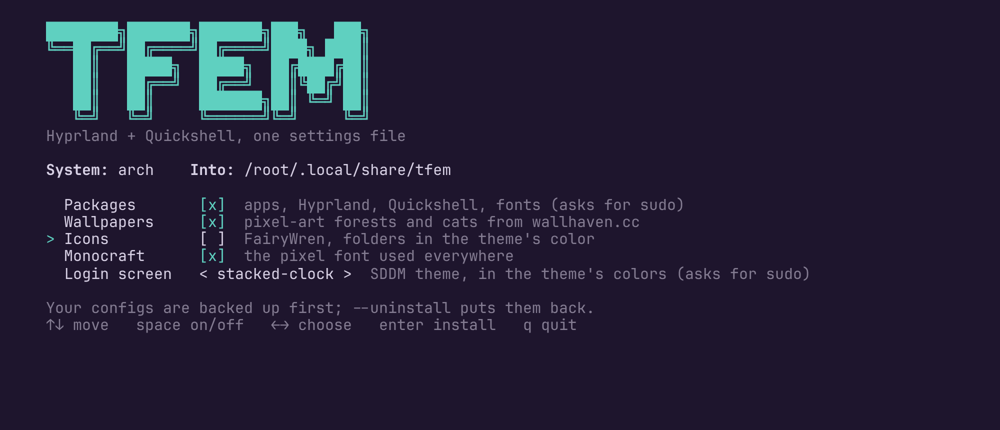

### Window manager: Hyprland, Sway or Niri

The first line of the install screen (or `--wm hyprland|sway|niri`) picks
the window manager; the same shell (bar, panels, dock, widgets, lock screen,
Settings) runs on all three, with the same keys.

| | Hyprland | Sway | Niri |
|---|---|---|---|
| Config written | `~/.config/hypr` | `~/.config/sway/config` | `~/.config/niri/config.kdl` (niri 25.11+) |
| Theme file (`tfem generate`) | `theme.lua` | `theme.conf`: border colors, gaps, font, cursor | `theme.kdl`: focus ring, gaps, rounded corners, cursor |
| Workspaces in the bar | yes | yes (Sway's IPC) | yes (`niri msg`) |
| `SUPER + Tab` | the shell's overview | — | niri's own overview |
| Lock fallback | hyprlock | swaylock | swaylock |
| Blur, game mode effects, night light, Settings → Display, keybind cheatsheet | yes | — | — |

Idle (dim, lock, screens off, suspend) is hypridle on all three; it turns
the screens off with the commands of the compositor in use. The packages
follow the choice: Hyprland, hyprlock and hyprsunset only for Hyprland,
Sway and swaylock for Sway, Niri and swaylock for Niri.

| Option | Effect |
|---|---|
| `--profile minimal` | desktop essentials only, no apps, fonts or wallpapers |
| `--dry-run` | show every step, change nothing |
| `--uninstall` | put your previous config back and remove the links |
| `--yes` | do not ask for confirmation |
| `--sddm welcome-panel` | the other login screen (default: `stacked-clock`) |
| `--no-packages`, `--no-wallpapers`, `--no-icons`, `--no-sddm` | skip that step |

The `tfem` command is in `~/.local/bin`: Hyprland adds that folder to the
`PATH` of the terminals it opens, so `tfem` works there even on distros that
leave it out (Arch does).

### Login screen

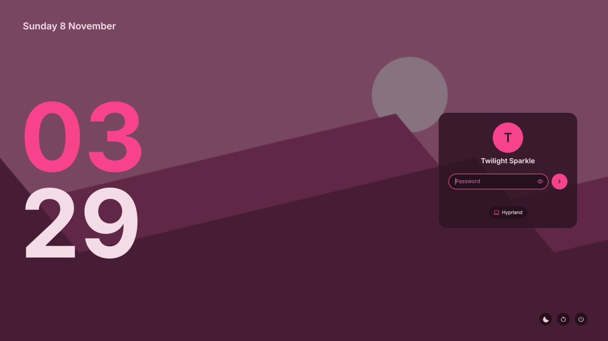

The **stacked clock**, installed by default: the date, a big clock in the
accent color, and the sign-in card as soon as you type. It follows the
theme: change it (or the wallpaper) and the login screen changes too, no
sudo needed. To look at it or reinstall it:

```bash
tfem sddm test stacked-clock
```

```bash
tfem sddm install stacked-clock --enable
```

`test` shows it in a window and installs nothing; `install` asks for sudo.
More in [Login screen (SDDM)](#login-screen-sddm).

Run the same command again to update. Installed packages are never removed.

### What each distro provides

The Hyprland config is written in Lua, which needs **Hyprland 0.55 or
newer**. Everything not listed below is in the official repositories of all
three families. The installer checks every package first and skips the
missing ones instead of failing.

| Package | Arch | Debian / Ubuntu | Fedora |
|---|---|---|---|
| hyprland | ✅ 0.57 | ✅ Debian testing/unstable (0.57); ❌ Debian 13; ❌ Ubuntu 26.04 (0.53, too old) | ❌ COPR needed |
| hyprlock | ✅ | ✅ Debian unstable, Ubuntu 26.04 | ❌ COPR needed |
| quickshell | ✅ 0.3 | ✅ 0.3 (Debian 13 via backports) | ⚠️ 0.2 snapshot |
| satty (screenshot editor) | ✅ | ❌ (screenshots are saved unedited) | ❌ (same) |
| cliphist | ✅ | ✅ | ✅ Fedora 44 |

On Fedora, the installer does not add third-party repositories by itself:
enable a COPR you trust (for example `sudo dnf copr enable sdegler/hyprland`)
and run it again. Versions checked on Repology on 2026-11-07.

### OpenBSD (in part)

OpenBSD has no Hyprland nor Quickshell yet (Hyprland's OpenBSD port is in
progress upstream), so the desktop itself cannot run there. The installer
still recognises OpenBSD and does the rest: it installs what OpenBSD 7.8
packages (Python, kitty, glib2, qt5ct and qt6ct, the Papirus and Adwaita
icons, the Inter and JetBrains Mono fonts, Firefox, Nautilus...) with
`doas pkg_add`, links the `tfem` command, downloads the wallpapers and the
icons, and themes your apps (kitty, GTK, Qt) with any of the 36 themes.
The Hyprland config, the shell and the login screen are left out, and it
says so. OpenBSD ships neither bash nor curl, so first:

```bash
doas pkg_add bash curl git
```

then the usual one-line command. Tested with stand-ins for `uname`,
`pkg_info`, `pkg_add` and `doas`, not on a real OpenBSD machine.

### Icons

The icon theme is [FairyWren](https://gitlab.com/FreshDoctor/FairyWren-Icons)
(GPL-3.0, Breeze parts LGPL-2.1), based on Papirus and Breeze. Like the
wallpapers it is not stored in this repository: `tfem icons fetch` downloads
only its two themes (about 160 MB) into `~/.local/share/icons`, and the
installer runs it for you. Papirus is installed too, as FairyWren falls back
on it for the icons it does not draw.

- **Dark or light** follows the palette: `FairyWren_Dark` for dark themes,
  `FairyWren_Light` for light ones (Catppuccin Latte).
- **Folders** take FairyWren's color that looks closest to the accent:
  green for Pine and Moss, orange for Tabby, violet for Dracula, cyan for
  Nord... Pick one yourself with `folders` (blue,
  cyan, green, indigo, magenta, pink, pine, red, teal, violet, yellow, ...).

```toml
[icons]
theme   = "FairyWren"   # or any installed icon theme, e.g. "Papirus-Dark"
folders = "theme"       # or "pink", "pine", ...
```

`tfem generate` applies it: GTK (gsettings), Qt (qt5ct, qt6ct) and the shell
(launcher).

### Wallpapers

`wallpapers/collection.toml` lists 26 pixel-art wallpapers from
[wallhaven.cc](https://wallhaven.cc), picked by hand: 15 forests (day,
night, mist, snow) and 11 cats. SFW, landscape, every one looked at. They
are downloaded to `~/Pictures/Wallpapers/forest/` and `cats/` and never
stored in this repository: the images remain the property of their authors.
Download or complete them at any time with `tfem wallpapers fetch`; it also
deletes the wallpapers taken out of the collection (the former My Little
Pony and forest ones), only those files.

Pick one with `SUPER + W` (see [Shell](#shell)) or `tfem wallpapers set
IMAGE`: the choice is saved in your `theme.toml`, and the desktop and the
lock screen follow. `tfem wallpapers list` shows what is in the folder; any
image you add there (jpg, png, webp) shows up in the selector.

**The theme has the colors of the wallpaper.** Pick a wallpaper in the
selector (`SUPER + W`): the shell reads its 8 main colors (Quickshell's
ColorQuantizer) and `tfem wallpapers set IMAGE --colors ...` makes the
theme from them. The hue that covers the most of the picture becomes the
theme's color: a green forest gives a green theme, a blue night street a
blue one, a magenta city a magenta one. The darkest color of that hue
gives the backgrounds (the lightest, with a light theme, for a light
image), its most vivid one the accent, and the theme builder makes every
color readable. An image without any color gets Noir. The whole desktop
follows: shell, terminal, GTK, Qt, Hyprland, lock and login screens.
Settings → Home shows the theme as "Wallpaper colors"
(`palette.source = "wallpaper"`). Without the colors (`tfem wallpapers set`
from a terminal), a wallpaper of the collection brings the theme made for it
(Moonlit, Lagoon, Autumn, Sakura, Velvet...).

```toml
[wallpaper]
follow = true                   # false: a wallpaper never changes the theme
```

## Themes

36 themes: 17 in every color of the wheel, 8 made from the wallpapers'
colors, 10 well-known palettes and **Noir**, black and white. **Moonlit**
is the default, with its night forest wallpaper.

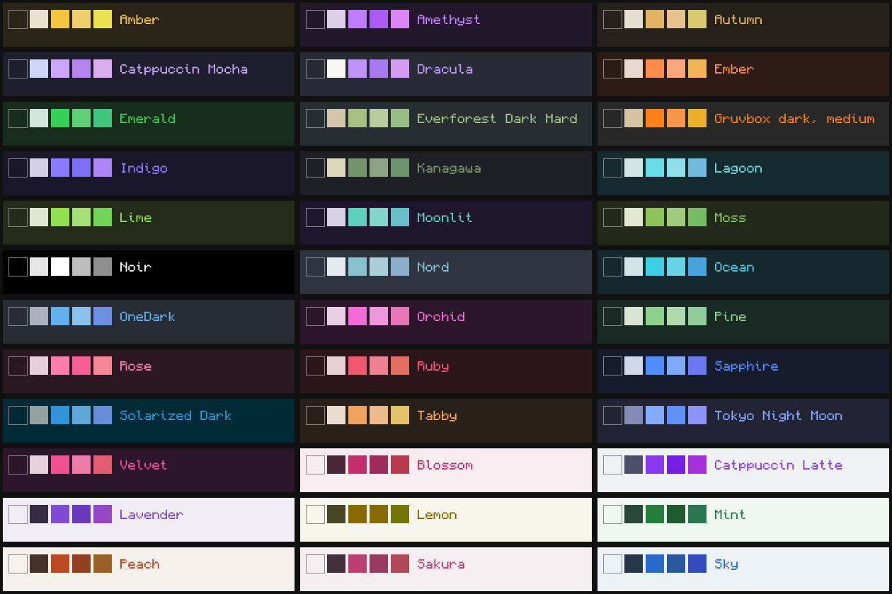

Each theme shows **5 colors**: its background, its text and its 3 own
colors (the squares above). The terminal, GTK, Qt, fastfetch and the shell
use only those 5. To get every color of a theme back (its red, green,
blue…), turn on **Every color of the theme** in Settings → Appearance, or
set `colors = "all"` under `[palette]` in `theme.toml`.

**Colors**, one theme per color, original: Ruby (red), Ember (orange),
Amber (yellow), Lime and Emerald (green), Ocean (cyan), Sapphire and
Indigo (blue), Amethyst (purple), Orchid (magenta), Rose (pink), and light
ones: Peach, Lemon, Mint, Sky, Lavender, Blossom (`color-ruby`…,
`themes/seeds/colors.toml`). Each is checked: its accent, backgrounds and
text are its color, the text readable.

| Theme | Look |
|---|---|
| `forest-moonlit` | indigo night sky, teal moon (from the night forest wallpaper) |
| `forest-lagoon` | deep teal, turquoise water (from the forest lake) |
| `forest-autumn` | brown bark, amber leaves (from the autumn wood) |
| `cat-sakura` | light: cherry blossom pink, sky blue (from the cat under the cherry tree) |
| `cat-velvet` | plum night, neon magenta (from the two cats in the city) |
| `forest-pine` | deep pine night, young-leaf green, lichen teal |
| `forest-moss` | olive moss, fresh green, sunlight yellow |
| `cat-tabby` | warm brown fur, ginger orange, cream text, green eyes |
| `noir` | pure black, white text and accent, greys |
| `catppuccin-mocha` | dark, mauve accent |
| `catppuccin-latte` | light, mauve accent |
| `dracula` | dark, purple |
| `nord` | arctic blue grey, frost blue |
| `gruvbox-dark-medium` | warm retro brown, orange |
| `tokyo-night-moon` | night blue |
| `everforest-dark-hard` | dark forest grey, soft green |
| `kanagawa` | ink night, autumn green |
| `onedark` | Atom's grey, blue |
| `solarized-dark` | teal night, blue |

The Settings window sorts them in five groups: **Forest & cats**,
**Colors**, **Well known**, **Black & white** and **Light**.

**Noir** (`noir`) is for black wallpapers: a pure black bar and panels,
white text and accent (the clock pill turns white), greys for everything
else; only red keeps a little color, so alerts still stand out.

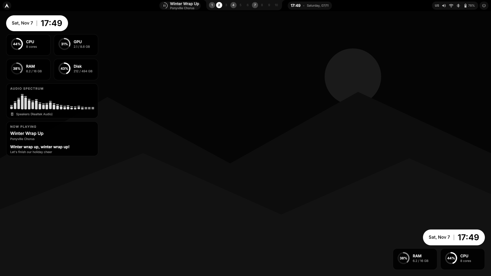

**Well-known palettes**, colors unchanged from
[tinted-theming/schemes](https://github.com/tinted-theming/schemes) (MIT, see
`licenses/MIT-tinted-theming.txt`), each with its signature color as accent.
`tools/import_tinted.py` imports them again from a copy of the schemes; when
a signature color is too pale or too dark to read on its background, only
its lightness is moved.

Pick one in `~/.config/tfem/theme.toml` (or in Settings → Appearance):

```toml
[palette]
source = "cat-tabby"
```

**Our themes** are original, not written by hand:
`themes/seeds/forest.toml` and `themes/seeds/cat.toml` hold a few colors
each (a pine wood, a ginger tabby, and the colors measured on the
wallpapers for Moonlit, Lagoon, Autumn, Sakura and Velvet), and
`PYTHONPATH=scripts python3 -m theming.builder themes/seeds/cat.toml` turns
them into full base16 themes, adjusting lightness until every color is
readable (WCAG contrast 7:1 for text, 4.5:1 for colors) and checking that
each hue stays in its place.

**Minimal colors:** a theme shows at most three colors, all its own. The
accent (workspaces, clock), a second color of the same family (every status
icon and the panels) and a third one used sparingly (the now-playing ring):
greens only for the forests, warm oranges for Tabby. Red is kept for alerts
only. Change it per module in `[modules]` of `theme.toml` if you want more
color (`wifi = "blue"`, for instance).

### fastfetch

`fastfetch` shows your system in the theme's colors: the boxed layout of
[harilvfs/fastfetch](https://github.com/harilvfs/fastfetch/blob/old-days/fastfetch/config.jsonc)
(hardware, software, uptime / age / date), its keys in the accent colors,
its frames in the quiet one, the distro logo and the percentages (memory,
disks) in the accent colors too. `tfem
generate` writes `~/.config/fastfetch/config.jsonc` (your old one is kept in
the backups), so it changes with the theme and the wallpaper. Its icons
need a Nerd Font symbol fallback (kitty has one).

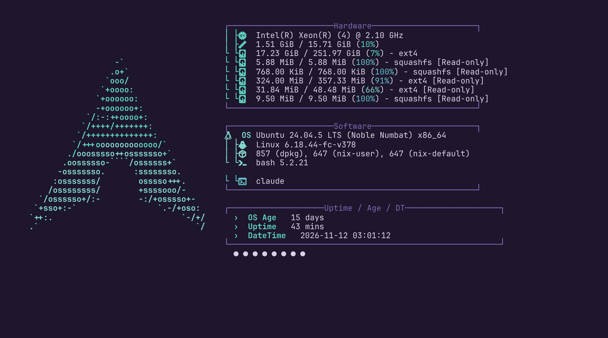

### Font

**[Monocraft](https://github.com/IdreesInc/Monocraft)**, a pixel font
(SIL Open Font License 1.1), is the font of the whole desktop by default:
the bar, the panels, the widgets and the lock screen, the terminal, GTK and
Qt apps, Hyprland's own messages and the login screen. The installer
downloads it (`tfem fonts fetch`, a pinned release checked against its
SHA-256) into `~/.local/share/fonts/Monocraft`; `tfem sddm install` also
copies it where the login screen can read it. Inter and JetBrains Mono stay
installed: pick another font in `theme.toml`.

```toml
[font]
sans = "Inter"                  # the shell, GTK and Qt
mono = "JetBrainsMono Nerd Font"  # the terminal
```

## How theming works

One file, `theme.toml`, describes the look of the whole desktop: palette,
accent, fonts, corners, gaps, blur, cursor, and the color of each shell module.
`tfem generate` turns it into the configuration files each app expects, in
their usual places:

```
theme.toml ──► validate ──► palette (base16) ──► templates ──► ~/.config/hypr/theme.lua
themes/*.toml ─────────────────┘                             ~/.config/hypr/hyprlock.conf
                                                             ~/.config/quickshell/<shell>/theme.json
                                                             ~/.config/kitty/theme.conf
                                                             ~/.config/gtk-3.0/theme.css, gtk-4.0/theme.css
                                                             ~/.config/qt5ct/…, ~/.config/qt6ct/…
```

- Palettes use the [base16](https://github.com/tinted-theming/home) format, so
  curated themes and palettes extracted from a wallpaper look the same to every
  template.
- Generated files never replace your own configs. When an app needs a line to
  load the generated file (for example `require("theme")` in `hyprland.lua`),
  that single line is added between clearly marked comments. Anything that
  would be overwritten is backed up first, in `~/.local/state/tfem/backups/`.
- Invalid settings are rejected with a clear message before anything is
  written.
- The terminal follows too: change the theme and the shell, the bar and
  every open kitty window take the new colors together. kitty loads them
  with one `include theme.conf` line at the end of your `kitty.conf`; move
  that block up if you want your own colors to win.
- Apps follow as well:
  - **GTK 4 / libadwaita** (Files, GNOME apps): `~/.config/gtk-4.0/theme.css`,
    loaded by one `@import` line at the top of your `gtk.css`.
  - **GTK 3**: the same in `~/.config/gtk-3.0/`, read by the adw-gtk3 theme
    (installed on Arch and Fedora; Debian does not package it, so GTK 3 apps
    keep the default look there).
  - **Qt 5 and Qt 6** (VLC, qBittorrent, KDE apps): a palette for qt5ct and
    qt6ct (`QT_QPA_PLATFORMTHEME=qt5ct` is set by the Hyprland config).
  - `gsettings` gets the GTK theme, dark or light style, icons and cursor,
    so open GTK apps change at once; Qt apps take the colors when they start.
  - Firefox draws its own colors: to have it follow GTK, set
    `widget.gtk.libadwaita-colors.enabled` to `false` in `about:config`.

Details: [docs/architecture.md](docs/architecture.md) and the template format
in [docs/templates.md](docs/templates.md).

## Try it

Requirements for this step: `bash` and Python 3.11 or newer.

```bash
./tfem generate --dry-run --all   # show what would be written
./tfem generate                   # write files for the apps you have installed
```

Your personal settings go in `~/.config/tfem/theme.toml` and
`~/.config/tfem/config.json`. Only the keys you write there replace the
defaults, for example:

```toml
[palette]
accent = "green"

[shape]
radius = 8
```

Run the tests with:

```bash
PYTHONPATH=scripts:tests python3 -m unittest discover -s tests
```

With Quickshell (`qs`) and sway installed, `tests/test_shell_runtime.py` also
runs the real shell in a headless sway session (software rendering, no GPU):
it fails if the shell does not load or if opening any panel logs an error in
its code. Without them it is skipped. With Hyprland installed,
`tests/test_hypr_verify.py` checks the config with `Hyprland --verify-config`
(run the tests as your user: Hyprland refuses root).

Checked on 2026-11-08 with the versions Arch Linux ships: Hyprland 0.57.1
(`config ok`) and Quickshell 0.3.2 (the shell loads, every panel opens).

## Hyprland config

`hypr/` is a complete Hyprland configuration in Lua (Hyprland 0.55 or newer),
split into small modules: variables, monitors, settings, animations,
autostart and keybinds. Every shortcut has a description; the full list is in
[docs/roadmap.md](docs/roadmap.md#3-quickshell-shell-bar-osd-launcher-notifications)
and in `hypr/config/keybinds.lua`.

- Every screen runs at its highest refresh rate, including screens plugged
  in later, unless you pick a mode for it in Settings → Display
  (`display.lua`, generated).
- Apps, modifier key and keyboard layout are set in
  `hypr/config/variables.lua`.
- Colors, gaps, corners and blur come from `theme.toml` through the generated
  `theme.lua`.

The installer copies it to `~/.config/hypr`. `SUPER + /` shows every
shortcut on screen. The tests load the config in a fake Hyprland API and check
every key: the dispatcher exists, the program it runs is installed by the
installer, and the shell panel it opens exists.

- **Lock screen** (`SUPER + L`, the power key, after the idle time and
  before suspend): the shell's own, in the style of the stacked clock login
  screen: your wallpaper under a veil, the date, the hours over the minutes
  in the accent color. Typing brings the card (your initial, your name, the
  password, the keyboard layout); a wrong password shakes it. It uses the
  Wayland session lock, so every window stays hidden until the password is
  accepted; the password is checked by PAM with the shell's own rule
  (`quickshell/lock/pam/password.conf`: your password, nothing else). When
  the shell is not running, the same keys start hyprlock instead, with a
  config generated from `theme.toml` (`~/.config/hypr/hyprlock.conf`).

  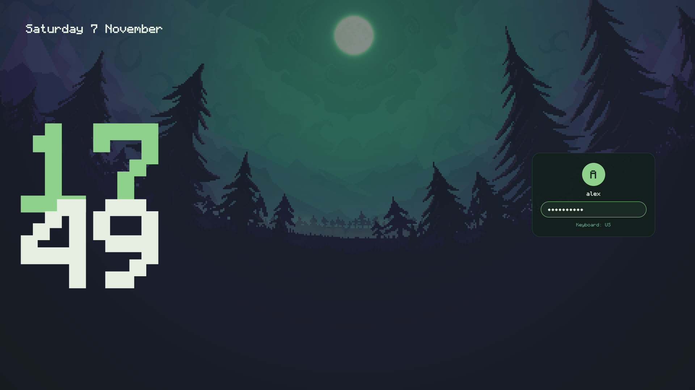

## Login screen (SDDM)

Two login screens for SDDM (Qt 6), in the colors, font and wallpaper of
your desktop theme:

| Stacked clock (default) | Welcome panel |
|---|---|
|  | 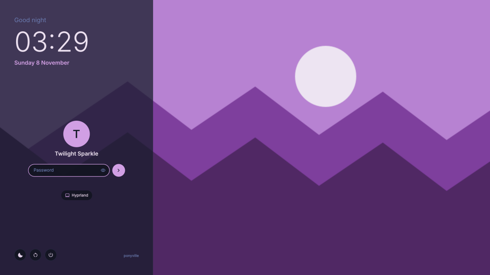 |

- **Stacked clock**: the whole wallpaper, the date at the top left and a
  large clock, hours stacked over minutes in the accent color. Any key or a
  click brings the sign-in card (what you type already goes into the
  password); Escape, or 30 seconds without typing, goes back to the clock.
- **Welcome panel**: your wallpaper, and on its left a frosted panel with a
  greeting, the time and date, who signs in (arrows when there are several
  users), the password with a show button and a Caps Lock warning, the
  session (Hyprland, or any other installed), and round suspend, restart and
  shut down buttons.

The installer installs SDDM and the stacked clock (`--sddm welcome-panel`
for the other one, `--no-sddm` to skip). By hand:

```bash
tfem sddm test stacked-clock               # look at it in a window, nothing installed
tfem sddm install stacked-clock --enable   # install, select, turn SDDM on (sudo)
```

`install` copies the theme to `/usr/share/sddm/themes/` and selects it in
`/etc/sddm.conf.d/zz-login-theme.conf`, read after the other files of that
folder. SDDM runs as its own user and cannot read your home, so the colors
and a copy of the wallpaper live in `/var/lib/tfem/sddm/`, a folder you own:
`tfem generate` (and so the Settings window and `tfem wallpapers set`) keeps
it up to date, without sudo. `--enable` turns SDDM on at the next start,
unless another login manager (GDM, LightDM…) is on: that one is left as is,
and the command tells you how to switch.

## Shell

`quickshell/` is the desktop shell, one Quickshell process started with
Hyprland. The installer copies it to `~/.config/quickshell/desktop/` (the
folder name is `shell.name` in your `config.json`). Its colors follow
`theme.toml` live: run `tfem generate` and the shell recolors itself.

- **Bar** (look of illogical-impulse): in the center now playing with a progress ring (click to play or pause), the
  workspaces 1 to 10 in a notch (click to switch), the clock and date; on the
  right the keyboard layout, sound, network, Bluetooth and battery, each in
  its module color.

  In Settings → **Tweaks** it goes on any edge of the screen: top (the
  default), bottom, left or right (narrow, everything stacked: the hours
  over the minutes, the workspaces in a column), and it can be **fully
  transparent**: no background, only its pills over the wallpaper
  (`bar.position` and `bar.transparent` in `config.json`). Windows and
  widgets keep clear of it on every edge.

  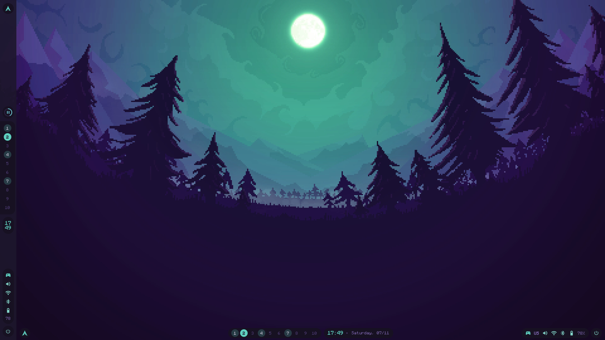
- **Dock**: your pinned apps, then the ones running, with a mark under the
  running ones (longer for the focused one). A click opens the app or brings
  its window forward (again: the next window); a right click pins or unpins
  it. Its colors are the theme's, so it changes with the theme and the
  wallpaper; Settings → **Dock** sets how see-through it is (20 to 100 %),
  its edge (bottom, left, right), and whether it hides until the pointer
  touches that edge (`dock.*` in `config.json`; `dock.pinned` lists desktop
  file ids, `"firefox,kitty,org.gnome.Nautilus"` by default).

  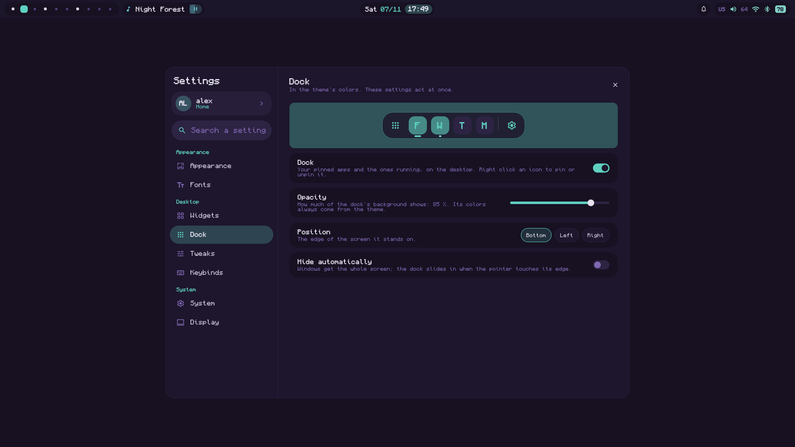
- **Distro logo** (top left of the bar), in the theme's accent color, the
  logo of the system you run: Arch, Fedora, Debian, Ubuntu, NixOS, Linux
  Mint, Pop!_OS, openSUSE, CachyOS, EndeavourOS, Manjaro, Gentoo, Void, Kali, Zorin,
  elementary, Alpine, Rocky, AlmaLinux, CentOS, Red Hat, Garuda, Nobara,
  Artix, MX, KDE neon, Slackware, Asahi, OpenBSD, FreeBSD (from
  `/etc/os-release`). A click opens the Settings window. Logos come from
  [Simple Icons](https://simpleicons.org) (CC0, `tools/import_logos.py`),
  each shown only on its own system, in one color and its own proportions,
  as trademark policies such as [Arch's](https://terms.archlinux.org/docs/trademark-policy/)
  ask: a system without its own logo here (Bazzite…) gets Tux.
- **Desktop widgets**, in the corner of the screen you pick (top left by
  default, or any of the other three), under the windows, in the colors of the theme,
  a little see-through (Hyprland's blur shows behind them, only inside
  their shape):

  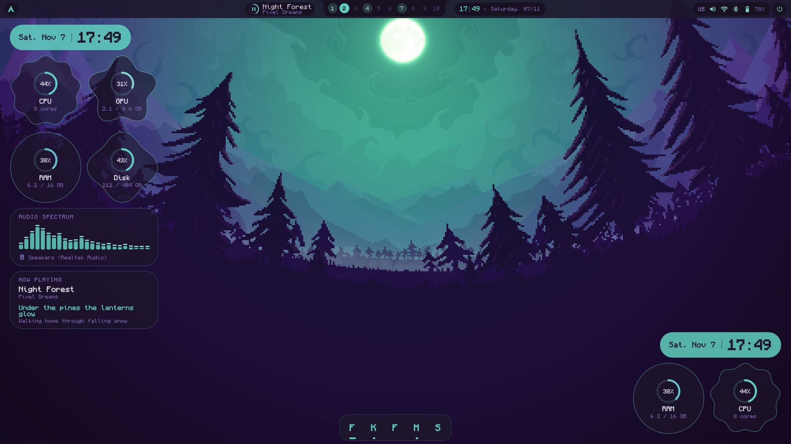

  - **Clock**: the date and the time in a pill of the accent color.
  - **CPU**, **GPU**, **RAM**, **Disk**, each in a soft organic shape (a
    scalloped cookie, a flower, a circle, a clover): a ring with the
    percentage, then the cores, or what is used out of the total. GPU: AMD (driver files)
    and NVIDIA (`nvidia-smi`); without a reading the card hides.
  - **Audio spectrum**: 24 bars drawn by [cava](https://github.com/karlstav/cava)
    (installed with the rest), with the device the sound plays on; cava
    stops in game mode and sleeps when nothing plays.
  - **Now playing**, kept minimal: the song, its artist and the line of the
    lyrics being sung (from lrclib.net), the next one under it.

  - **Calendar**: this month, its weeks starting on your language's first
    day, today in the accent color, the weekend in the second color.

  **Move them anywhere**: Settings → Widgets → **Move…** (or
  `qs ipc call widgets edit`) brings the widgets above the windows, framed:
  drag each one where you want it, "Back to the corner" puts them all back,
  Done or Escape ends. Each place is saved in `config.json`
  (`widgets.places.clock = "0.97,0.08"`: parts of the free space of the
  screen, so it stays put on any screen size); the widgets never moved stay
  stacked in their corner.

  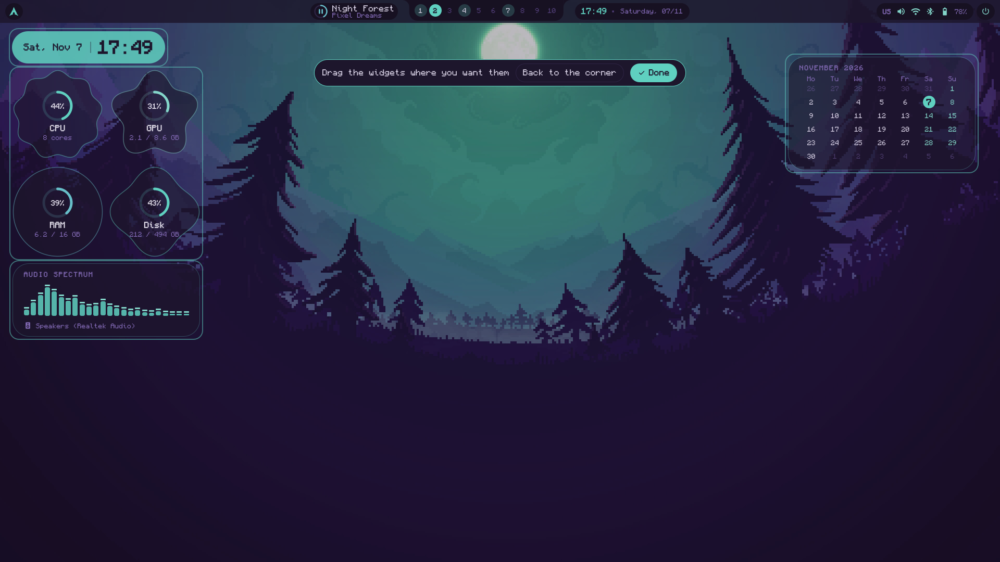

  Each one is turned on or off in Settings → **Widgets**, where a small
  screen picks the corner with a click (`widgets.*` in `config.json`,
  `widgets.corner`: `top-left`, `top-right`, `bottom-left`, `bottom-right`). Only what shows runs: CPU and memory are read from
  `/proc` every 2 seconds, the disk every minute.
- **Modes**, in Settings → **Tweaks** (or **Gaming hub** on the Home
  page): one tile per mode, a click turns it on or off; each shows an icon
  in the bar while it is on.

  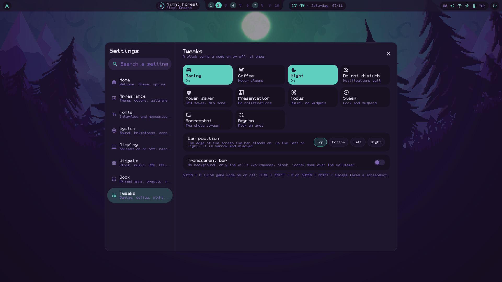

  - **Gaming** (also `SUPER + G`, and Settings → System): Hyprland drops
    what costs frames (no animations, blur or shadows); a fullscreen game
    may **tear** (less input lag) and goes straight to the screen (**direct
    scanout**); [Feral GameMode](https://github.com/FeralInteractive/gamemode)
    is asked for its optimisations (the CPU in performance).
  - **Coffee**: the screen never dims, locks or sleeps.
  - **Night**: a warmer screen (hyprsunset at 4000 K; yours, if it already
    runs, is set back to its profile after), a dimmer one (the level before
    comes back), notifications wait.
  - **Do not disturb**: notifications wait (urgent ones still show).
  - **Power saver**: the power profile goes to power-saver (and back to the
    one before after), no animations, blur or shadows, a dimmer screen.
    Gaming and power saver are never on together.
  - **Presentation**: no notification at all, the screen never sleeps,
    widgets hidden.
  - **Focus**: notifications wait, widgets hidden.
  - **Sleep**: locks, then suspends.

  In gaming, power saver, focus and presentation the desktop widgets hide
  and stop reading the CPU, the disk and the sound. Notifications that wait
  are all in the system panel's history.
- **OSD** under the bar for the volume and the brightness.
- **Notifications**: the shell is the notification daemon; popups in the
  top-right corner, urgent ones stay until closed.
- **Wallpaper**: drawn by the shell itself, under the windows (no other
  program needed); a new one fades in.
- **Screen recording** (`SUPER + ALT + R`, again to stop): the screen in
  focus, with wf-recorder, saved to `~/Videos/Screencasts`; a red dot in
  the bar while it records, a notification at the start and with the file
  at the end. From a terminal: `tfem record` (`region` for an area picked
  with the mouse, `--audio` to add the microphone). On Hyprland, Sway and
  Niri.
- **Workspace overview** (`SUPER + Tab`): workspaces 1 to 10 as small
  screens, each window where it is, as a live picture (Hyprland's toplevel
  export). Click a workspace to go there, a window to bring it forward;
  drag a window onto another workspace to move it there (you stay where you
  are). 1 to 9 and 0 pick a workspace, Escape closes.

  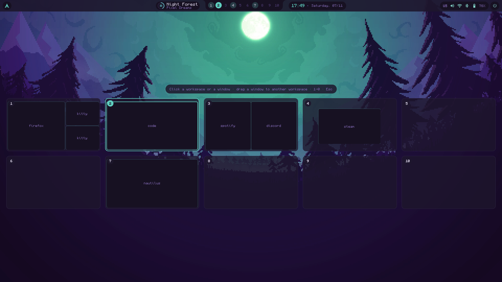
- **Launcher** (`SUPER + D`): search and open apps. Every word typed is
  looked for in the name, description, keywords and command, so `nautilus`
  finds Files. Terminal apps (btop, nvim…) open in your terminal
  (`terminal` in `hypr/config/variables.lua`).
- **Network panel** (`SUPER + N`, or a click on the status icons of the
  bar): quick toggles for Wi-Fi, Bluetooth and airplane mode, then two tabs.
  *Wi-Fi*: every network with its signal, lock and "Saved" mark, connected
  one first; the password is typed right under the network, a wrong one is
  said so; disconnect, forget, rescan; cable connection and "no internet"
  warning. *Bluetooth*: your devices with their type icon and battery,
  connect or disconnect in one click, forget; devices nearby to pair (they
  are then trusted and connected); "visible to other devices". Colors are
  the Wi-Fi and Bluetooth module colors of the theme. Devices that ask for
  a pairing code are not supported yet (pair them once with `bluetoothctl`).
- **Settings** (`SUPER + H`, or the gear of the system panel): a window
  in quiet colors, the pages on the left, each setting with one sentence
  saying what it does.
  - **Home**, where it opens: a banner on the wallpaper with a greeting for
    the time of day ("Good evening, alex"), the date and time, the theme,
    the uptime and the system, a moon, and two buttons: **Wallpaper** and
    **Gaming hub** (the Tweaks page). Under it, one card per page.

    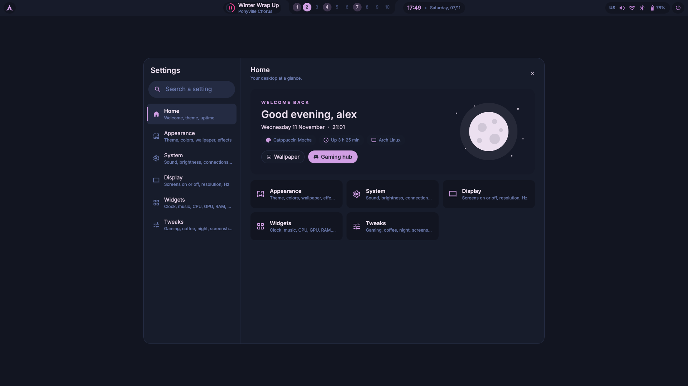
  - **Appearance**: theme (the 36 as cards in their own colors, with
    filters), accent color, wallpaper, folder color, rounded corners, space
    between windows, transparency, blur, shadows, animations, text size.
    Nothing changes until **Apply**: a small desktop at the top shows the
    result first (bar, window, panel), and a bar at the bottom counts the
    changes waiting, with Cancel.
  - **Fonts**: the interface font (bar, panels, Settings, GTK and Qt
    apps) and the monospace one (terminal), each picked in the list of the
    fonts installed, drawn in its own face, with a search; sizes 9 to 14;
    a sample on top. They act at once.

    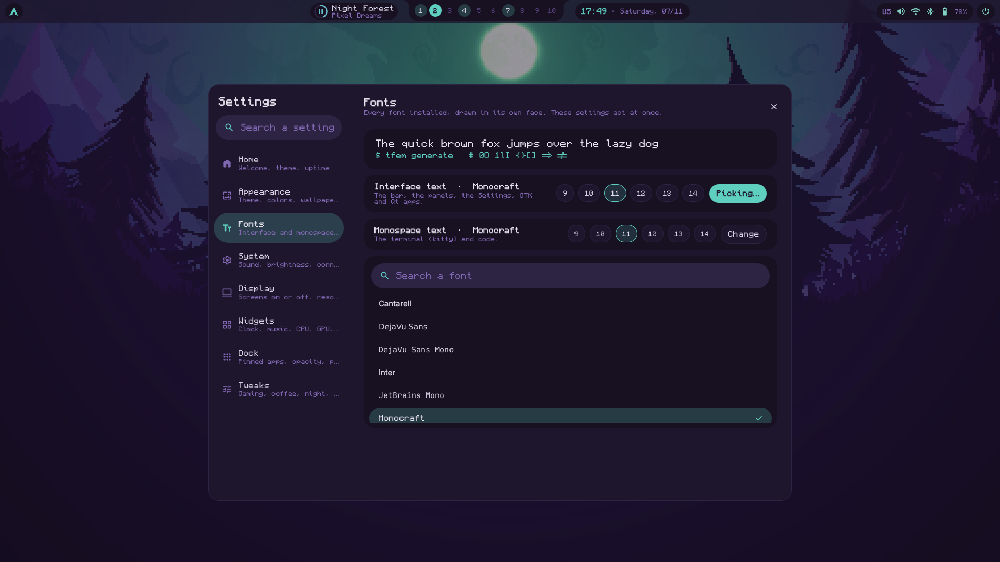
  - **System**, acting at once: **game mode** (see Modes below), sound and
    microphone, brightness, Wi-Fi and Bluetooth (with their panel), keyboard
    layout, quiet mode, stay awake, and **sleep**: after how long the
    screen dims, locks, turns off and the computer suspends (or never).
  - **Display**: each screen **on or off** with a switch, its **refresh
    rate** and resolution as one-click choices (165 Hz, 144 Hz, 60 Hz… or
    Highest). It acts at once and asks "Keep this change?": without an
    answer it goes back after 15 seconds, in case a screen stays black. The
    last screen on cannot be turned off. Same from a terminal:
    `tfem display list`, `tfem display set DP-1 2560x1440@165.08`,
    `tfem display auto DP-1`, `tfem display off HDMI-A-1`,
    `tfem display on HDMI-A-1`. The choice is saved in `config.json`
    (`display.modes`) and written to `~/.config/hypr/display.lua`, loaded
    by `config/monitors.lua`; other screens keep the highest refresh rate.

    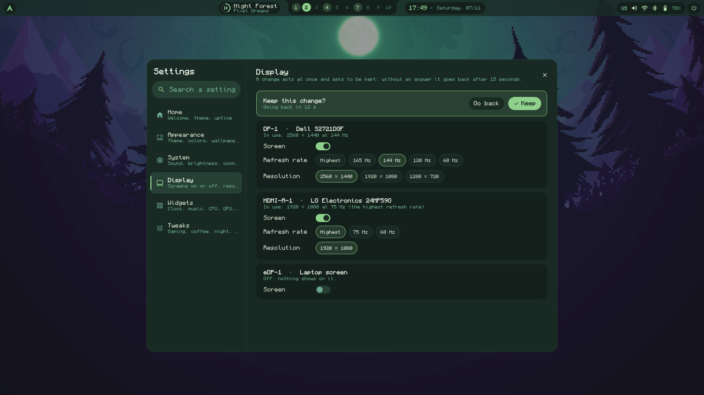
  - **Search** at the top: "blur", "wifi" or "sleep" lists the matching
    settings; Enter goes to the first one and lights it up.
  - Everything goes through `tfem settings get` and `tfem settings set
    KEY=VALUE`, checked like the files and written to your `theme.toml` or
    `config.json` (comments kept), then the theme is regenerated.
- **System panel** (`SUPER + B`), on the right: Wi-Fi, Bluetooth,
  airplane, **Quiet** (do not disturb: no popups except urgent ones, a bell
  shows in the bar) and **Stay awake** (no dimming, lock or sleep, a cup
  shows in the bar); volume and brightness; the last 50 notifications, to
  dismiss one by one or all at once. Quiet and stay awake survive a
  restart of the shell.
- **Idle** (hypridle, `~/.config/hypr/hypridle.conf`, generated from the
  `idle` section of `config.json`): dim after 5 min, lock after 10, screen
  off after 11, suspend after 30 (0 = never; change them in Settings);
  locked before any suspend.
- **Power menu** (`SUPER + Escape`, or the power button at the right end
  of the bar): lock, log out, suspend (locks first), restart, shut down,
  with the time since start-up. Log out, restart and shut down ask for a
  second click; arrows and Enter or one letter (L, E, S, R, P) work too.
- **Music** (`SUPER + M`): the album sleeve with its record sliding out,
  turning while the music plays; title, artist, album; progress you can
  click to move in the song; previous, play/pause, next, shuffle, repeat;
  the choice of player when several are open (Spotify, Firefox…); and the
  lyrics on request, synced with the song (from lrclib.net, asked only when
  you open the lyrics: title, artist, album and length are sent).
  Lyrics are found for almost every song, whatever plays it: the names are
  cleaned first (YouTube's "Artist - Song (Official Video)" by "Artist -
  Topic", "feat." guests, "Remastered 2011"...), then the exact match is
  asked, then without the album, then lrclib's searches, keeping synced
  lyrics of the closest length; a version too far from yours (a video with
  a long intro) gives its words without the timing. What is found is kept
  for the session, for the panel and the widget alike.
- **Volume panel** (`SUPER + V`): output volume and mute, choice of output
  (speakers, headphones, HDMI), microphone and its choice, then one slider
  per app playing sound, with its icon and what it plays. Click, drag or
  scroll; click an icon to mute. On PipeWire through Quickshell.
- **Calendar** (`SUPER + S`, or a click on the clock): time and date, the
  month in your language with week numbers, today circled; arrows or the
  wheel change month, "Today" comes back.
- **Wallpaper selector** (`SUPER + W`): slanted cards in a carousel, or a
  grid; filters by color (each image's main color is found once, in the
  background, then remembered), recent picks, random pick and search. Left
  and right arrows browse (also while searching), Enter applies, typing
  searches. It never changes the wallpaper on its own.
- **Clipboard history** (`SUPER + C`): what you copied (kept by cliphist),
  searchable; Enter copies it again.
- **Keybind cheatsheet** (`SUPER + /`): read from Hyprland itself, so your own
  binds show up too.
- **Bar autohide** (`SUPER + A`): windows get the whole screen, the bar comes
  down when the pointer touches the top edge.

Still to come: the sidebars, the dock, the Mono style, the settings window and
the panels opened by the other keys.

To see it without a Wayland session (it renders the shell's own QML files with
sample data):

```bash
pip install PySide6-Essentials
```
```bash
python3 tools/preview/render.py --theme cat-tabby --wallpaper your-image.png --out preview/
```

## Repository layout

```
theme.toml            default look of the desktop (the single source of truth)
config.json           default shell behaviour (shell name, sleep, widgets, screens)
tfem                  CLI
hypr/                 Hyprland config in Lua (copied to ~/.config/hypr/)
quickshell/           the shell: wallpaper, bar, widgets, OSD, notifications, panels
install.sh, install/   one-command installer and its package table
wallpapers/           wallpaper collection (list only, images are downloaded)
themes/               base16 palettes, one file per theme
templates/            one template per generated file + targets.toml manifest
scripts/generate.sh   entry point of the generator
scripts/screenshot.sh screenshots (region or full screen, optional editing)
scripts/wallpapers.py wallpapers: download, list, set (with the theme they bring)
scripts/wallpaper_collection.py  the collection and the theme of each wallpaper
scripts/settings.py, display.py  `tfem settings` and `tfem display` (the Settings window)
scripts/theming/      generator: settings, palette, template engine, safe writer
extras/sddm/           the two login screens (tfem sddm install)
tools/                icon generator, preview renderer
tests/                unit and end-to-end tests, golden files
licenses/             licenses of bundled third-party material
docs/                 architecture, template format, roadmap
```

## Make it yours

- **Shell name:** the Quickshell config lives in
  `~/.config/quickshell/<name>/`. Set `shell.name` in your `config.json`
  (default `desktop`).
- **Colors:** pick any theme with `palette.source`, an accent with
  `palette.accent` (`theme` keeps the theme's signature color), and change
  single colors with `[palette.overrides]`.
- **Your own themes:** drop a base16 theme file in `~/.config/tfem/themes/`. It
  takes precedence over the bundled one with the same name.
- **CLI name:** prefer `dots` or `wm`? Link to the same script; its help uses
  whatever name you called it with:
  `ln -s "$PWD/tfem" ~/.local/bin/dots`

More renaming options (displayed name, avatar, hostname) arrive with the
Settings window.

## Credits and inspiration

- **[Serpantinum](https://github.com/ilyamiro/serpantinum)** (AGPL-3.0) shaped
  the architecture: a single Quickshell shell kept apart from the compositor
  config, one settings file applied live, palettes from presets or from the
  wallpaper with per-color overrides, and app theming that writes a separate
  theme file plus one marked include line instead of overwriting configs.
  Only ideas were reused: TFEM is an original implementation and contains no
  Serpantinum code.
- **[FairyWren](https://gitlab.com/FreshDoctor/FairyWren-Icons)** (Isaiah M,
  GPL-3.0 and LGPL-2.1): the icon theme, downloaded on your machine, never
  copied into this repository; the folder color is set through its own
  `places/colours/default` link, as its `colours.sh` does.
- **[Simple Icons](https://github.com/simple-icons/simple-icons)** (CC0-1.0):
  the Arch Linux logo of the bar (`quickshell/components/logos.js`). The
  logo itself is a trademark of Arch Linux; this project is not affiliated
  with it.
- **[Material Symbols](https://github.com/google/material-design-icons)**
  (Google, Apache-2.0, see `licenses/Apache-2.0.txt`): the shell's icons,
  extracted by `tools/fetch_icons.py`.
- **[end-4/dots-hyprland](https://github.com/end-4/dots-hyprland)**
  (illogical-impulse): the look of the bar, rebuilt with original code.
- **[tinted-theming](https://github.com/tinted-theming/schemes)** (MIT) for
  the base16 palettes and the standard terminal color mapping.
- Visual references for the upcoming shell and login screens are listed in
  [docs/roadmap.md](docs/roadmap.md).

## License

[GPL-3.0](LICENSE).
